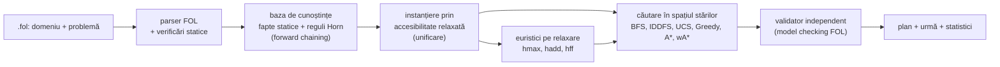

# Integrarea logicii cu căutarea: un planificator simplu

Proiect de laborator, Tema 5, *Knowledge Representation and Problem-Solving*.

Planificatorul primește o descriere a lumii scrisă în **logică de ordinul întâi**
(fapte, reguli Horn, axiome, acțiuni cu precondiții și efecte) și caută o
**secvență validă de acțiuni** care duce din starea inițială într-o stare în
care scopul, tot o formulă FOL, este adevărat.

Este scris în Python 3.10+ și folosește doar biblioteca standard, fără
dependențe externe.

| Cerința din enunț | Unde se găsește |
|---|---|
| Definirea domeniului problemei | 3 domenii în [`domains/`](domains): Blocks World, planificarea sarcinilor unei echipe, robot de livrare |
| Reprezentarea regulilor în FOL | limbajul `.fol`: cuantificatori, reguli Horn, axiome, constrângeri ([docs/LIMBAJ.md](docs/LIMBAJ.md)); motorul de inferență din [`planner/logic/`](planner/logic) |
| Un algoritm de căutare pentru o secvență validă de acțiuni | 7 algoritmi și 5 euristici în [`planner/planning/search.py`](planner/planning/search.py) și [`heuristics.py`](planner/planning/heuristics.py); validator independent |
| Codul planificatorului | [`planner/`](planner) |
| Exemple de planuri generate | [docs/EXEMPLE.md](docs/EXEMPLE.md) și [`examples/plans/`](examples/plans) |
| Documentație | acest fișier, [docs/LIMBAJ.md](docs/LIMBAJ.md), docstring-urile din cod |

## Structura proiectului

```text
planner/            codul planificatorului
  logic/            sintaxa FOL, parser, unificare, inferență
  planning/         domenii, instanțiere, căutare, euristici, validare
  cli.py            interfața în linie de comandă
  mcp_server.py     serverul MCP
domains/            domeniile și problemele (.fol)
examples/plans/     planuri generate, cu urma fiecărui pas
docs/               referința limbajului și exemplele comentate
scripts/            regenerarea exemplelor
tests/              testele automate (unittest)
```

## Pornire rapidă

Nu e nevoie de nicio instalare: comenzile de mai jos rulează direct din
folderul proiectului (pe Windows `py`, pe Linux/macOS `python3`). Opțional,
`pip install -e .` adaugă comanda `planner` în terminal.

```powershell
py -m planner solve domains/blocks/domain.fol domains/blocks/sussman.fol --trace
```

```text
Domain    BlocksWorld
Problem   SussmanAnomaly
Search    A*, h = hff   (successors: grounded)
h(init)   5

Plan: 6 steps, total cost 6
  1. Unstack(C, A)
  2. PutDown(C)
  3. PickUp(B)
  4. Stack(B, C)
  5. PickUp(A)
  6. Stack(A, B)

Expanded 10   generated 23   max frontier 5   time 0.001 s

Validation OK: valid plan: 6 steps, cost 6; every precondition, axiom and constraint holds and the goal is reached
```

Toate comenzile:

| Comandă | Ce face |
|---|---|
| `solve D P [-a ALG] [-H EUR] [--trace] [-o plan.txt] [--json]` | caută un plan, îl validează și opțional îl salvează |
| `validate D P plan.txt [--trace]` | verifică un plan scris de mână sau generat |
| `compare D P [--configs bfs ucs astar:hmax ...]` | rulează mai mulți algoritmi și afișează un tabel |
| `query D P "Above(x, D)" [--after plan.txt]` | răspunde la o interogare FOL în starea inițială sau după un plan |
| `inspect D P` | afișează domeniul în notație logică, tipul predicatelor și numărul de acțiuni instanțiate |
| `unify "Knows(John, x)" "Knows(y, Mother(y))"` | calculează unificatorul cel mai general |
| `mcp` | pornește serverul MCP (vezi mai jos) |

`-a` poate fi `bfs`, `dfs`, `iddfs`, `ucs`, `greedy`, `astar`, `wastar`, iar
`-H` poate fi `blind`, `goal_count`, `hmax`, `hadd`, `hff`.

## Cum arată un domeniu

Extras din [`domains/blocks/domain.fol`](domains/blocks/domain.fol):

```text
domain BlocksWorld
types: Block
predicates: On(x, y), OnTable(x), Clear(x), Holding(x), HandEmpty, Above(x, y)

derive: On(x, y) -> Above(x, y)
derive: On(x, y) & Above(y, z) -> Above(x, z)

axiom: forall x, y: On(x, y) -> ~Clear(y)
axiom: forall x: ~Above(x, x)

action Stack(x: Block, y: Block)
    pre: Holding(x) & Clear(y) & x != y
    eff: On(x, y) & Clear(x) & HandEmpty & ~Holding(x) & ~Clear(y)
```

și o problemă cu scop cuantificat universal ([`one_tower.fol`](domains/blocks/one_tower.fol)):

```text
goal: OnTable(D) & (forall x: Block(x) & x != D -> Above(x, D))
```

Planificatorul nu primește ordinea blocurilor în turn: scopul spune doar că
fiecare bloc trebuie să fie *undeva deasupra* lui D, iar `Above` nu este
modificat de nicio acțiune, ci dedus din reguli.

## Arhitectura



| Modul | Rol |
|---|---|
| [`logic/syntax.py`](planner/logic/syntax.py) | termeni (variabile, constante, funcții), atomi și formule; substituție fără capturarea variabilelor |
| [`logic/parser.py`](planner/logic/parser.py) | parser recursiv-descendent pentru formule, cu simboluri ASCII și Unicode |
| [`logic/unify.py`](planner/logic/unify.py) | algoritmul de unificare al lui Robinson, cu occurs check (AIMA, fig. 9.1) |
| [`logic/reasoning.py`](planner/logic/reasoning.py) | interogări conjunctive prin unificare, model checking pentru orice formulă, reguli Horn și forward chaining semi-naiv |
| [`planning/domain.py`](planner/planning/domain.py) | formatul de fișier, scheme de acțiuni, verificarea domeniului și a problemei |
| [`planning/task.py`](planner/planning/task.py) | spațiul stărilor: modelul unei stări, instanțierea acțiunilor, simplificarea părților statice |
| [`planning/search.py`](planner/planning/search.py) | algoritmii de căutare |
| [`planning/heuristics.py`](planner/planning/heuristics.py) | euristicile |
| [`planning/validate.py`](planner/planning/validate.py) | validatorul de planuri |
| [`cli.py`](planner/cli.py), [`mcp_server.py`](planner/mcp_server.py) | interfața în linie de comandă și serverul MCP |

### Cum se combină logica și căutarea

1. **Starea** este o mulțime de atomi ground *fluenți* (care se schimbă).
   Împreună cu faptele statice și cu ce deduc regulile, ea formează un
   **model Herbrand** sub ipoteza lumii închise.
2. **Predicatele derivate** (`Above`, `Precedes`, `Reachable`) se calculează cu
   forward chaining semi-naiv. Regulile care depind doar de fapte statice
   (`Connected` din `Door`) se evaluează o singură dată, iar celelalte în
   fiecare stare.
3. **Precondițiile și scopurile** sunt formule FOL oarecare. Ele se evaluează
   prin model checking: atomii pozitivi se rezolvă prin unificare cu faptele,
   iar pentru `forall x: G -> C` se enumeră doar legările care satisfac
   garda G, nu toate tuplurile de obiecte.
4. **Instanțierea acțiunilor** (grounding) folosește o analiză de
   accesibilitate relaxată: se pornește din starea inițială, se unifică
   atomii pozitivi ai precondițiilor cu faptele atinse și se adaugă efectele
   pozitive, până la punct fix. Părțile statice ale precondițiilor sunt apoi
   evaluate o dată pentru totdeauna, iar cuantificatorii sunt expandați peste
   mulțimea finită de obiecte. Modul `--mode lifted` sare peste acest pas și
   generează succesorii direct prin interogări cu unificare; testele verifică
   faptul că ambele moduri produc exact aceiași succesori.
5. **Căutarea** explorează spațiul stărilor înainte (progresie). Euristicile
   informate se calculează pe **relaxarea fără ștergeri**, în care regulile
   Horn devin acțiuni cu cost 0.
6. **Validatorul** nu refolosește acțiunile instanțiate pentru căutare: el
   reinstanțiază fiecare pas din schema scrisă în fișier, verifică precondiția
   completă, aplică efectele, verifică axiomele și constrângerile în noua stare
   și, la final, scopul.
7. **Axiomele** verificate pe starea inițială detectează baze de cunoștințe
   inconsistente înainte de căutare (de exemplu, dependențe ciclice între
   sarcini), iar planificatorul raportează un contraexemplu.

## Algoritmi și euristici

| Algoritm | Complet | Optim | Observații |
|---|---|---|---|
| `bfs` | da | în număr de pași | test de scop la generare |
| `dfs` | da (spațiu finit) | nu | cu mulțime de stări vizitate; `--depth-limit` opțional |
| `iddfs` | da | în număr de pași | memorie liniară; verifică ciclurile pe drumul curent |
| `ucs` | da | în cost | Dijkstra |
| `greedy` | da (spațiu finit) | nu | f = h; de obicei cel mai rapid |
| `astar` | da | în cost, dacă h e admisibilă | f = g + h; redeschide nodurile când găsește un g mai bun |
| `wastar` | da | cost ≤ w · optim (h admisibilă) | f = g + w·h, implicit w = 2 |

| Euristică | Admisibilă | Idee |
|---|---|---|
| `blind` | da | h = 0 (A* devine UCS) |
| `goal_count` | nu | numărul de conjuncte ale scopului încă false |
| `hmax` | da | costul celui mai scump atom necesar în relaxare |
| `hadd` | nu | suma costurilor atomilor (Bonet & Geffner) |
| `hff` | nu | costul unui plan relaxat explicit (Hoffmann & Nebel, FF) |

Pentru precondiții care nu sunt simple conjuncții (disjuncții, cuantificatori
expandați), costul relaxat se definește pe forma normală negativă:
`cost(A ∧ B) = cost(A) + cost(B)` (max pentru hmax),
`cost(A ∨ B) = min(...)`, `cost(¬atom) = 0`. Costurile atomilor se calculează
cu un algoritm Dijkstra generalizat (Knuth, 1977), cu contoare pentru
operatorii conjunctivi. O euristică infinită dovedește că scopul nu poate fi
atins nici în relaxare; nodul este eliminat, iar dacă este starea inițială,
problema e declarată fără soluție fără a expanda niciun nod.

## Domeniile incluse

| Domeniu | Ce ilustrează |
|---|---|
| **Blocks World** ([`domains/blocks`](domains/blocks)) | predicat derivat recursiv (`Above`), axiome-invariant, scopuri cu `forall` și cu predicate derivate, anomalia Sussman, o problemă cu 8 blocuri pentru compararea euristicilor |
| **Planificarea sarcinilor** ([`domains/scheduling`](domains/scheduling)) | precondiții cu cuantificatori universali (toate dependențele gata, toate competențele prezente), costuri numerice `Size(t) * Rate(w)`, instruire ca acțiune, o constrângere de numărare exprimată în FOL („nimeni nu face mai mult de două sarcini”), detectarea dependențelor ciclice prin axiome, detectarea problemelor fără soluție |
| **Robot de livrare** ([`domains/delivery`](domains/delivery)) | uși simetrice prin reguli, tipuri derivate (`Item`), uși încuiate și chei, accesibilitate derivată cu negație, o constrângere de siguranță („obiectul fragil se transportă singur”), scop `∀p: Package(p) → ∃r: Destination(p, r) ∧ At(p, r)` |

## Rezultate

Rezultatele complete, cu planuri și tabele comparative pentru toți
algoritmii, sunt în [docs/EXEMPLE.md](docs/EXEMPLE.md) (generat de
`scripts/generate_examples.py`). Câteva observații:

- Pe **planificarea sarcinilor**, BFS găsește planul cel mai scurt (7 pași,
  38 de ore), dar UCS și A* găsesc planul **cel mai ieftin** (8 pași, 37 de ore):
  merită să-l instruiești pe Dan în Python (4 ore) ca să facă Backend-ul la
  tariful lui mai mic. Greedy și A* cu hadd dau planuri corecte, dar mai
  scumpe, pentru că folosesc euristici neadmisibile.
- Pe **Blocks World cu 8 blocuri**, BFS, IDDFS și UCS nu termină în limitele
  tabelului (20 s / 100 000 de noduri). A* cu hmax, singura euristică
  admisibilă informată, are nevoie de aproximativ 49 000 de expandări
  (circa 35 s pe un laptop) pentru planul optim de 18 pași, iar A* cu hff
  găsește un plan de aceeași lungime după 802 expandări (0,7 s).
- Pe **robotul de livrare**, constrângerea „vaza se transportă singură” elimină
  între 86 (A* cu hff) și 868 (BFS) de stări generate; greedy găsește rapid un plan de 21 de pași, iar
  algoritmii optimi găsesc unul de 19.
- Problema cu **dependențe ciclice** este respinsă înainte de căutare, cu
  contraexemplul `t = Backend` pentru axioma `∀t: ¬Precedes(t, t)`.

## Integrare MCP

[`planner/mcp_server.py`](planner/mcp_server.py) expune planificatorul prin
Model Context Protocol (JSON-RPC 2.0 pe stdio, implementat doar cu biblioteca
standard), astfel încât un asistent AI (Claude Code, Claude Desktop, MCP
Inspector) poate rezolva probleme, valida planuri și interoga baza de
cunoștințe ca tool-uri:

| Tool | Descriere |
|---|---|
| `planner_list_examples` | domeniile și problemele incluse |
| `planner_describe_task` | domeniul în notație logică și statistici |
| `planner_solve` | caută și validează un plan |
| `planner_validate_plan` | verifică un plan pas cu pas |
| `planner_query` | interogare FOL, opțional după un plan |
| `planner_unify` | unificatorul cel mai general a doi termeni |

Toate tool-urile sunt read-only. `domain` și `problem` pot fi un nume de
exemplu inclus (`"blocks"`, `"sussman"`), o cale către un fișier `.fol` sau
chiar textul fișierului.

Fișierul [`.mcp.json`](.mcp.json) din rădăcină înregistrează serverul pentru
Claude Code când proiectul e deschis în acest folder. Manual:

```powershell
claude mcp add fol-planner -- py -m planner.mcp_server
```

Pe un sistem unde interpretorul se numește `python` sau `python3`, se
înlocuiește `py` în comanda de mai sus și în `.mcp.json`.

## Teste

```powershell
py -m unittest discover -s tests -t .
```

57 de teste acoperă unificarea (inclusiv cazurile din AIMA §9.2.2 și occurs
check), parserul, substituția, model checking-ul, forward chaining-ul
(comparat cu o închidere naivă), optimalitatea UCS/A*/BFS/IDDFS pe toate
problemele, echivalența succesorilor lifted/grounded, euristicile, validatorul,
erorile de modelare, CLI-ul și serverul MCP ca proces separat.

## Legătura cu materia

| Tema de la curs | Unde apare în proiect |
|---|---|
| Logica propozițională | predicatele 0-are (`HandEmpty`), conectorii și forma normală negativă folosită de euristici |
| Logica de ordinul întâi | tot limbajul de modelare: cuantificatori, egalitate, funcții, modele Herbrand finite |
| Unificarea | `unify.py`; folosită la interogări, la forward chaining, la instanțierea acțiunilor și la succesorii lifted |
| Rezoluția | forward chaining-ul pe clauze Horn este rezoluție unitară pozitivă (modus ponens generalizat); rezoluția generală pentru clauze arbitrare nu este implementată, pentru că verificarea formulelor se face prin model checking pe un model finit |
| Algoritmi de căutare | BFS, DFS, IDDFS, UCS, Greedy, A*, Weighted A*, cu euristici derivate automat din reprezentarea logică |

## Limitări

- Efectele sunt conjuncții de literali (nu există efecte condiționale sau
  cuantificate).
- Negația în reguli e permisă doar pe predicate nederivate.
- Cuantificatorii iau valori peste toate obiectele; tipurile se exprimă prin
  predicate unare în formule (`forall x: Block(x) -> ...`).
- Costurile sunt numere nenegative; nu există timp continuu sau acțiuni
  paralele.
- Fiind scris în Python pur, planificatorul e potrivit pentru probleme de
  ordinul a zeci de mii de stări, nu pentru benchmark-urile IPC mari.

## Bibliografie

- S. Russell, P. Norvig, *Artificial Intelligence: A Modern Approach*, ed. 4, 2021, cap. 3, 8, 9, 11.
- R. Fikes, N. Nilsson, „STRIPS: A New Approach to the Application of Theorem Proving to Problem Solving”, *Artificial Intelligence* 2, 1971.
- B. Bonet, H. Geffner, „Planning as Heuristic Search”, *Artificial Intelligence* 129, 2001.
- J. Hoffmann, B. Nebel, „The FF Planning System: Fast Plan Generation Through Heuristic Search”, *JAIR* 14, 2001.
- J. A. Robinson, „A Machine-Oriented Logic Based on the Resolution Principle”, *JACM* 12, 1965.
- D. Knuth, „A Generalization of Dijkstra's Algorithm”, *Information Processing Letters* 6, 1977.
